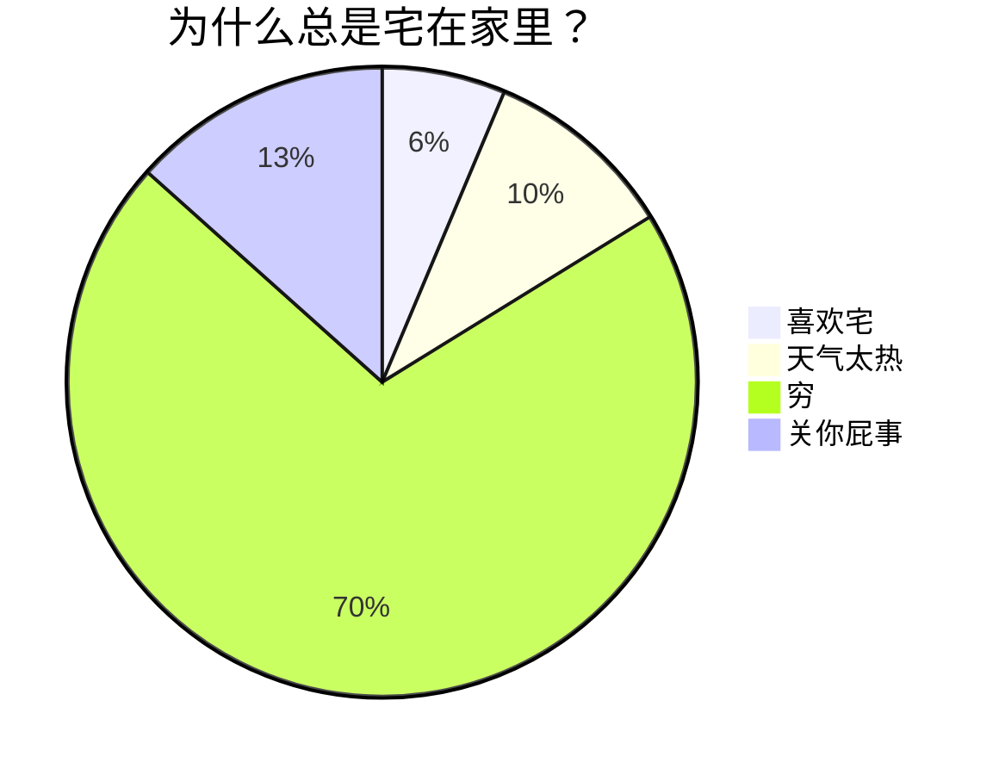

这是一段普通的文本

# 这是一级标题
## 这是二级标题
### 这是三级标题
#### 这是四级标题
##### 这是五级标题
###### 这是六级标题
*这是斜体*
_也是斜体_

**这里是一段加粗文本**
__这也是一段加粗文本__


***粗斜体文本1***
___粗斜体文本2___
**_粗斜体文本3_**
*__粗斜体文本5__*
_**粗斜体文本6**_


下面是两种不同形式的  一条水平分割线：
---
***

~~这是一段加了删除线的文本~~

<u>这是一段加了下划线的文本</u>

1. 这是第一个有序列表 <!-- (Enter) -->
2. 这是第二个有序列表 <!-- (Enter) -->
3. 这是第三个有序列表 


1. 这是第一个有序列表 <!-- (Shift + Enter) -->
   这是同个列表下，另起一行的文本内容 <!-- (Enter) -->
2. 这是第二个有序列表 <!-- (Shift + Enter) -->
   这是同个列表下，另起一行的文本内容
   

- 10.这是无序列表下，整十数排列的内容<!-- (-点式) -->
- 20.这是无序列表下，整十数排列的内容
- 30.这是无序列表下，整十数排列的内容


- 100.这是无序列表下，整百数排列的内容
- 200.这是无序列表下，整百数排列的内容
- 300.这是无序列表下，整百数排列的内容
>这是第一段引用文本的第1行 <!-- (Enter) -->
>这是第一段引用文本的第2行 <!-- (Enter) -->
<!-- (Enter) -->
>这是第二段引用文本的第1行 <!-- (Enter) -->
>这是第二段引用文本内第2行

>汉皇重色思倾国

>我要向星辰下令

>我要做风的君王  

                            by阿多尼斯 

缩进：

Tab

Ctrl + [   (左中括号)

退格：

Shift + Tab

Ctrl + ] （右中括号）

1. 第一级有序列表1 <!-- (Enter) -->
	1. 第二级有序列表1    <!-- 写文本之前，先( Tab 或 Ctrl + ] ) ；写完文本后，再(Enter) -->
	2. 第二级有序列表2 <!-- (Enter) -->
2. 第一级有序列表2    <!-- 写文本前，先 ( Shift + Tab 或 Ctrl + [ ) -->

- 第一级无序列表1 <!-- (Enter) -->
	- 第二级无序列表1  <!-- 写文本前，先( Tab 或 Ctrl + ] ) ；写完后，再(Enter) -->
	- 第二级无序列表2 <!-- (Enter) -->
- 第一级无序列表2  <!-- 写文本前，先 ( Shift + Tab 或 Ctrl + [ ) -->

7. 明月几时有

    1. 把酒问青天
    2. 不知天上宫阙
8. 今夕是何年

    3. 我欲乘风归去

>李白
>>床前明月光
>>>疑是地上霜

1. 第一级 有序列表1 <!-- (Shift + Enter) --> 
	- 第二级 无序列表1 <!-- (Shift + Enter) -->
		>第三级 引用1  <!-- (Enter) -->
			- 第四级 无序列表2 <!-- (Shift + Enter) -->
            	1. 第五级 有序列表2 <!-- (Enter) -->
            - 第四级 无序列表3   <!-- 写文本前，先( Shift + Tab 或 Ctrl + [ ) ；写完后再 (Enter) -->
        >第三级 引用2  <!-- 写文本前，先( Shift + Tab 或 Ctrl + [ ) ；写完后再 (Enter × 2) -->
    - 第二级 无序列表4  <!-- 写文本前，先( Shift + Tab 或 Ctrl + [ ) -->
2. 第一级 有序列表3  <!-- 写文本前，先( Shift + Tab 或 Ctrl + [ ) -->

[显示文本内容](链接地址 "提示信息文本")

[百度一下，你就知道](http://www.baidu.com "按住Ctrl点击跳转百度")

[YOUTUBE](https://m.youtube.com "sdxfghjk")

	


<!--区分表头和表格主体，:代表文本对齐方式，分别是左对齐，居中对齐，右对齐-->

|这里是表头1|这里是表头2|这里是表头3|
|:-|:-:|-:|    
|单元格数据1|单元格数据2|单元格数据3|
|单元格数据4|单元格数据5|单元格数据6|

| 表头1 |  表头2 |
|:-:|:-:|
|这是第一行文本<br>这是另起一行的文本|普通文本|

`这是一段行内代码`

`<table border="1" cellspacing="0" width="500" height="500">`

`print("Hello, World!")`

`这是一行突出显示的文本内容`

```语言种类
代码内容
代码内容
代码内容
```

下面是HTML代码块

```html
<table border="1">
    <tr>
        <td>row 1, cell 1</td>
        <td>row 1, cell 2</td>
    </tr>
    <tr>
        <td>row 2, cell 1</td>
        <td>row 2, cell 2</td>
    </tr>
</table>
```

下面是CSS代码块

```css
.box {
	width: 600px;
	height: 400px;
	margin: 100px auto;
	background-image: linear-gradient(black 33.3%,red 33.3%, red 66.6%, yellow 66.6%, yellow);
}	
```

下面是JavaScript代码块

```js
    // 定义一个30个整数的数组，按顺序分别赋予从2开始的偶数；然后按顺序每五个数求出一个平均值，放在另一个数组中并输出。试编程
    var arr = [2, 4, 6, 8, 10, 12, 14, 16, 18, 20, 22, 24, 26, 28, 30, 32, 34, 36, 38, 40, 42, 44, 46, 48, 50, 52, 54, 56, 58, 60]
    var newarr = [];
    for (var i = 0, count = 0, sum = 0, len = arr.length; i < len; i++) {
        sum += arr.shift();
        count++;
        if (count % 5 === 0) {
            newarr.push(sum / 5);
            sum =  0;
        }
    }
    console.log(newarr);

    var arr = [2, 4, 6, 8, 10, 12, 14, 16, 18, 20, 22, 24, 26, 28, 30, 32, 34, 36, 38, 40, 42, 44, 46, 48, 50, 52, 54, 56, 58, 60]
    var newarr = [];
    for (var i = 0, len = arr.length; i < len / 5; i++) {
        var subarr = arr.splice(0, 5)
        for (var j = 0, sum = 0; j < subarr.length; j++) {
            sum += subarr[j];
        }
        newarr.push(sum / 5);
    }
    console.log(newarr);
```


下面是Python代码块

```python
#!/usr/bin/python
# -*- coding: UTF-8 -*-

i = 2
while(i < 100):
   j = 2
   while(j <= (i/j)):
      if not(i%j): break
      j = j + 1
   if (j > i/j) : print i, " 是素数"
   i = i + 1
 
print "Good bye!"
```

下面是一块突出显示的文本

```txt
这是一段
突出显示的
文本内容
```

- [ ] 待办任务列表1
                - [ ] 待办任务列表2
    - [x] 已办任务列表1    <!-- 英文字母X -->
- [x] 已办任务列表2

- [ ] 城阙辅三秦
    - [x] 风烟望五津

<!-- 这里是一行注释 -->

<!--
这里是
一段
假装有
很多行的
注释
-->

[百度一下，你就知道][度娘]

[知乎-有问题，就会有答案][知乎]

<!-- 这里是变量区域 -->
[度娘]: http://www.baidu.com 
[知乎]: https://www.zhihu.com

[YOUTUBE][油管]

[油管]: https://m.youtube.com
<br>
<br>
鲁迅原名是什么[^1] ，浙江哪里人[^2]

<!-- 这里是变量区域 -->
[^1]: 周树人
[^2]: 绍兴人

<font color=orange>这是一段橘色文本</font>

<font color=#FF7892>海洋的颜色是蓝色的</font>
<br>
<br>

|表头1|表头2|
|-|-|
|这里的文本被\|分隔|这里的文本也被\|分隔|

>The Web, the Tree, and the String.

>写作之难，在于把网状的思考，用树状结构，体现在线性展开的语句里。

>\- 史蒂芬·平克   <!-- 加上转义符号 \ , 不会变成无序列表 -->

<br>
<br>
这里有&nbsp;&nbsp;&nbsp;&nbsp;&nbsp;&nbsp;6个空格分隔

这里第一段文本

<br><br><br><br><br>     <!-- 这里插入了5个空行间距 -->

这里是第二段文本

<audio controls="controls" preload="none" src="https://www.ldoceonline.com/media/english/exaProns/p008-001803372.mp3?version=1.2.30"></audio>

<br>
<video width="600" height="420" controls>
  <source src="movie.mp4" type="video/mp4">
  <source src="movie.ogg" type="video/ogg">
  <source src="movie.webm" type="video/webm">  
</video>
<!--width ( 宽度 ) height ( 高度 ) ，可以自己设置，直接输入数字即可，单位默认是 px(像素)
也可以使用 百分比
width=100% 代表水平撑满整个窗口
height=50% 代表垂直撑满半个窗口
Video标签 支持的视频格式 ：MP4 ogg webm -->
<br>
<!--latex公式-->
<br>
<br>

$$
$\ce{Zn^2+  <=>[+ 2OH-][+ 2H+]  $\underset{\text{amphoteres Hydroxid}}{\ce{Zn(OH)2 v}}$  <=>[+ 2OH-][+ 2H+]  $\underset{\text{Hydroxozikat}}{\ce{[Zn(OH)4]^2-}}$}$
$$

<!-- 麦克斯韦方程组 -->
$$
\begin{array}{lll}
\nabla\times E &=& -\;\frac{\partial{B}}{\partial{t}}   
\ \nabla\times H &=& \frac{\partial{D}}{\partial{t}}+J   
\ \nabla\cdot D &=& \rho
\ \nabla\cdot B &=& 0
\ \end{array}
$$

<br>
